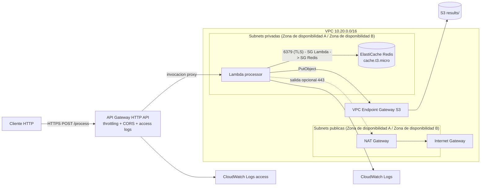

# Servicio de procesaimiento Cache: API Gateway + Lambda + Redis + S3

Todo se despliega con  `terraform apply`.

## Arquitectura



Flujo de datos:

```
Cliente → API Gateway → Lambda (VPC) → Redis ─ HIT  → Respuesta inmediata   X-Cache: HIT
                                          └─ MISS → procesar → S3 → Redis SET EX 60 → Respuesta X-Cache: MISS
```

## Estructura del repositorio

```
.
|-- versions.tf  variables.tf  outputs.tf  terraform.tfvars.example
|-- network.tf          VPC, subnets, Internet Gateway, NAT, rutas y VPC Endpoint de S3
|-- security_groups.tf  security Groups de Lambda y de Redis
|-- redis.tf            subnet Group y ElastiCache Redis
|-- s3.tf               bucket, bloqueo de acceso publico, versionado y bucket policy
|-- iam.tf              rol de la Lambda con minimo privilegio
|-- lambda.tf           funcion Lambda y su grupo de logs
|-- api_gateway.tf      HTTP API, ruta, stage, throttling, CORS y logs de acceso
|-- lambda/             codigo de la Lambda (Python 3.12) y pruebas unitarias
|-- scripts/            scripts (Linux y Windows) para generar X-Cache: MISS y X-Cache: HIT 
`-- evidence/           X-Cache: MISS y X-Cache: HIT y opcionables
```

## Pre-requisitos

| Herramienta | Version |
|---|---|
| Terraform | >= 1.6 |
| AWS CLI | V2 Local log y evidencia |
| Curl | Cualquiera |
| Python | 3.10 + |

Permisos AWS del usuario IAM que despliega: 
- Crear y borrar VPC/EC2 (subnets, IGW, NAT, EIP, SG, endpoints)
- ElastiCache, Lambda, API Gateway v2, S3, IAM (roles y policies), CloudWatch Logs

## Despliegue desde cero

```bash
git clone <URL_DEL_REPO> && cd <repo>

# 1. Credenciales AWS (ejemplo con perfil)
export AWS_PROFILE=mi-perfil
aws sts get-caller-identity          # confirma la cuenta y copia tu ARN

# 2. Variables
cp terraform.tfvars.example terraform.tfvars
#    Edita terraform.tfvars y pon tu ARN en s3_admin_principal_arns (necesario para `aws s3 ls`)

# 3. Despliegue 
terraform init
terraform apply
```

Tarda ~10-15 min

## Verificacion end-to-end

```bash
API_URL=$(terraform output -raw api_url)

# Request 1 → X-Cache: MISS
curl -i -X POST "$API_URL" -H 'Content-Type: application/json' -d '{"message":"hola mundo"}'

# Request 2 → X-Cache: HIT
curl -i -X POST "$API_URL" -H 'Content-Type: application/json' -d '{"message":"hola mundo"}'

# Objeto S3
aws s3 ls "s3://$(terraform output -raw results_bucket)/results/" --recursive

# Preflight CORS
curl -i -X OPTIONS "$API_URL" -H 'Origin: https://ejemplo.com' -H 'Access-Control-Request-Method: POST'

# Logs
aws logs tail "$(terraform output -raw lambda_log_group)" --since 10m
aws logs tail "$(terraform output -raw api_access_log_group)" --since 10m
```

Para generar los archivos de `evidence/` de forma las respuestas:

```bash
./scripts/capture_evidence.sh
```

Pruebas unitarias de la Lambda (sin AWS):

```bash
python -m unittest discover -s lambda/tests -v
```

## Destruir el stack - Dado que es una prueba se ejecuto para este proyecto despues

```bash
terraform destroy
```

## Costos

| Recurso | Costo aprox. (us-east-1) |
|---|---|
| NAT Gateway | ~$0.045/h + $0.045/GB ≈ $32/mes |
| Elastic IP del NAT | ~$0.005/h |
| ElastiCache `cache.t3.micro` | ~$0.017/h ≈ $12/mes |
| VPC, subnets, IGW, SG, VPC Endpoint Gateway S3 | $0 |
| Lambda, HTTP API, S3, CloudWatch | Centavos dado que es trafico de prueba |

Se podria configurar un AWS Budget antes de empezar

## Decisiones de diseño

**Throttling.** Esta en `default_route_settings` del stage: 50 peticiones por segundo sostenidas y
rafagas de hasta 100. Son variables, se pueden cambiar.
 
**CORS.** Abierto a cualquier origen, como se pidio. Con `*` no se pueden usar credenciales, asi
que `allow_credentials` esta en `false`. Ademas `X-Cache` esta en `expose_headers` para que un
navegador pueda leer ese encabezado.
 
**Redis cache.t3.micro.** Es el nodo mas barato de ElastiCache que permite cifrado. Se usa un
replication group de un solo nodo (sin replicas ni failover) porque asi se activan el cifrado en
transito (TLS) y en reposo. Es una cache: lo duradero esta en S3, por eso no hay snapshots. Para
produccion se agregaria una replica y multi-AZ.
 
**TTL siempre explicito.** El cliente Redis de la Lambda solo ofrece `SET clave valor EX ttl` y
rechaza un TTL menor o igual a cero. No hay forma de guardar una clave sin expiracion.
 
**Cliente Redis propio, con la libreria estandar.** `lambda/redis_client.py` implementa solo
GET y SET con EX sobre el protocolo RESP, con TLS (unas 90 lineas). Asi la Lambda no necesita
empaquetar `redis-py` y un solo `terraform apply` basta, sin pasos de build. En un proyecto con
mas comandos usaria `redis-py` en una layer.
 
**Clave de cache.** Es el SHA-256 de `{body, query}` en JSON canonico con las claves ordenadas, asi
`{"a":1,"b":2}` y `{"b":2,"a":1}` dan la misma clave.
 
**S3.** Los objetos van en `results/<clave>.json`. El bucket tiene las 4 opciones de Block Public
Access en `true`, versionado, cifrado SSE-S3, `BucketOwnerEnforced` y una regla que borra versiones
antiguas a los 30 dias. La bucket policy:
 
- Permite leer y escribir solo al rol de la Lambda.
- Niega el acceso a objetos a cualquier otro, salvo los ARN de `s3_admin_principal_arns`.
- Obliga al rol de la Lambda a entrar por el VPC Endpoint (`aws:SourceVpce`).
- Exige TLS.
No se niegan las acciones de configuracion del bucket, para que Terraform no se bloquee a si mismo.
 
**Seguridad de red.**
 
- Lambda y Redis estan en subnets privadas, sin IP publica.
- El Security Group de la Lambda solo permite salir hacia el SG de Redis por el 6379 y hacia S3 por
  443 (usando la prefix list del VPC Endpoint). El de Redis solo acepta entrada por el 6379 desde
  el SG de la Lambda y no tiene salida.
- El NAT Gateway y su ruta existen como pide el diseno de red, pero el SG de la Lambda no abre
  salida a internet por defecto. Si la funcion necesitara llamar a una API externa, se activa
  `lambda_allow_internet_egress = true`.
- La politica del VPC Endpoint limita el acceso al bucket de este stack.
**Manejo de errores.** `lambda_handler` captura cualquier excepcion, la registra con su traza
completa en CloudWatch y responde HTTP 500 con `error`, `message` y `request_id`. Una peticion sin
body ni query devuelve 400. Si Redis falla, la peticion devuelve 500 (es lo que pide el enunciado);
la alternativa seria seguir sin cache.

**Servicios de monitoreo y permisos** CloudWatch Logs (access logs del API y logs de Lambda con retencion configurable),
IAM (rol con minimo privilegio). No se uso Secrets Manager porque Redis no usa auth token: el control de acceso
es por Security Group + TLS. Para endurecerlo, se añade `auth_token` en Secrets Manager.

## Variables

Ver `variables.tf` y `terraform.tfvars.example`: region, CIDRs, `single_nat_gateway`, tipo de nodo Redis, TTL,
throttling (`api_throttling_rate_limit`, `api_throttling_burst_limit`), CORS, retencion de logs, etc.

## Respuestas MISS y HIT

La carpeta `evidence/` contiene los logs de la ejecucion real (MISS → HIT y `aws s3 ls`). Se generan con
`./scripts/capture_evidence.sh` tras el despliegue; ver `evidence/README.md`.
